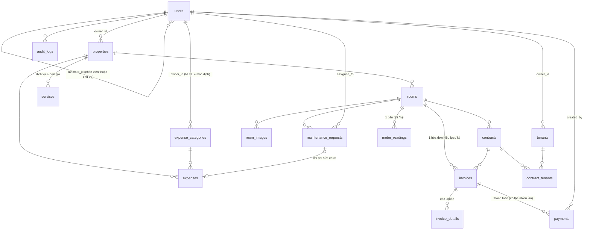
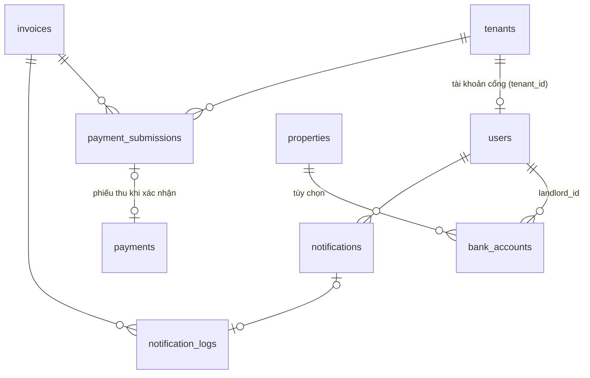

# StayManager – Kiến trúc & Cơ sở dữ liệu

## 1. Kiến trúc tổng thể

```
desktop/ (Electron) ─┬─ cửa sổ giao diện: frontend/ (React 18 + Vite + TypeScript + Tailwind)
                     │        ──HTTP/JSON (JWT Bearer, 127.0.0.1)──►
                     └─ máy chủ chạy trong app: backend/ (Express + TypeScript + Prisma)  ──►  SQLite (1 file)
```

Xem mục 9 về bản cài trên máy tính.

* **backend/** – REST API, chia theo module (`src/modules/<module>/*.routes.ts`, nghiệp vụ phức tạp nằm trong `*.service.ts`).
  * `middleware/auth.ts` – xác thực JWT, phân quyền theo vai trò.
  * `middleware/error.ts` – xử lý lỗi tập trung (Zod, Prisma, ApiError).
  * `lib/scope.ts` – **cô lập dữ liệu**: mọi truy vấn đều đi qua bộ lọc chủ sở hữu (owner).
  * `lib/audit.ts` – ghi `audit_logs` cho các thao tác quan trọng.
  * Mọi thao tác tài chính (tạo hóa đơn, thanh toán, hủy phiếu thu, sửa chỉ số đã lập hóa đơn) chạy trong **transaction** và khóa dòng bằng `lockRow` (`UPDATE … SET id = id` – SQLite khóa ghi toàn CSDL nên các giao dịch ghi được tuần tự hóa).
* **frontend/** – SPA, `src/components/ui` (component dùng chung), `src/components/layout`, `src/pages/<module>`, `src/api` (axios + kiểu dữ liệu).

Định dạng phản hồi API thống nhất:

```json
{ "success": true, "data": ..., "meta": { "page": 1, "pageSize": 20, "total": 57, "totalPages": 3 } }
{ "success": false, "error": { "code": "VALIDATION_ERROR", "message": "…", "details": { "field": "…" } } }
```

## 2. Phân quyền & cô lập dữ liệu

| Vai trò | Phạm vi dữ liệu | Quyền |
|---|---|---|
| ADMIN | Toàn hệ thống | Quản lý tài khoản chủ trọ/nhân viên, xem mọi dữ liệu |
| LANDLORD | Dữ liệu có `owner_id = chính mình` | Toàn quyền trên dữ liệu của mình, tạo tài khoản nhân viên |
| STAFF | Dữ liệu của chủ trọ quản lý mình (`users.landlord_id`) | Vận hành hằng ngày; **không** xóa khu trọ/phòng, không quản lý tài khoản, **số CCCD bị che** |

`owner_id` nằm trên `properties`, `tenants`, `expense_categories`; các bảng khác suy ra chủ sở hữu qua quan hệ (room → property → owner).

## 3. ERD



### Giải thích quan hệ
* **users**: một bảng cho cả 3 vai trò. Nhân viên trỏ tới chủ trọ qua `landlord_id`.
* **properties** (khu trọ) thuộc 1 chủ trọ; có giá điện/nước riêng → hỗ trợ giá khác nhau theo khu.
* **services**: dịch vụ cố định theo khu (Internet, gửi xe, vệ sinh, khác), tính theo phòng hoặc theo người; được đưa vào hóa đơn khi tạo.
* **rooms**: duy nhất theo (`property_id`, `room_number`). Trạng thái `AVAILABLE | OCCUPIED | MAINTENANCE` được đồng bộ bởi hợp đồng.
* **tenants** thuộc chủ trọ; CCCD duy nhất trong phạm vi chủ trọ.
* **contracts** – hợp đồng thuê 1 phòng; **contract_tenants** (bảng nối N-N) cho phép nhiều người thuê trên 1 hợp đồng, lưu ngày vào/ra.
* **meter_readings** – chỉ số điện nước theo kỳ `YYYY-MM`, duy nhất theo (room, period). Lưu đơn giá tại thời điểm ghi.
* **invoices** – hóa đơn tháng; `period_key` = `period` khi còn hiệu lực, `NULL` khi đã hủy → ràng buộc UNIQUE(`room_id`, `period_key`) chống trùng hóa đơn nhưng vẫn cho phép lập lại sau khi hủy.
* **invoice_details** – từng khoản; `invoices.total_amount` luôn = tổng `amount` (tính lại ở server).
* **payments** – thanh toán từng phần; không xóa, chỉ **hủy (void)** kèm lý do.
* **expenses** – sổ thu chi khác (`type = INCOME | EXPENSE`), phân loại qua **expense_categories**. Tiền thuê thu được lấy từ `payments`.
* **maintenance_requests** – yêu cầu sửa chữa; khi hoàn thành có thể tự sinh khoản chi.
* **audit_logs** – lịch sử thay đổi (giá trị cũ/mới dạng JSON).

## 4. Quy tắc nghiệp vụ & cách thực thi

| # | Quy tắc | Thực thi |
|---|---|---|
| 1-3 | Mỗi phòng tối đa 1 hợp đồng ACTIVE; phòng OCCUPIED ⇔ có hợp đồng ACTIVE | Tạo/kết thúc hợp đồng trong transaction, khóa dòng phòng; trạng thái phòng chỉ đổi qua hợp đồng (API phòng từ chối đặt OCCUPIED thủ công) |
| 4 | Không trùng hóa đơn | UNIQUE(`room_id`,`period_key`) + kiểm tra trước khi tạo |
| 5 | Tiêu thụ không âm | Zod + kiểm tra server: chỉ số mới ≥ chỉ số cũ |
| 6 | Tổng hóa đơn = tổng chi tiết | Server tự tính lại tổng mỗi khi tạo/sửa khoản |
| 7-8 | Thanh toán từng phần, đủ tiền ⇒ PAID | Transaction + khóa dòng hóa đơn (`lockRow`), không cho trả vượt số còn nợ |
| 9 | Quá hạn | Trạng thái **suy ra**: còn nợ và `due_date < hôm nay` (giờ Việt Nam) ⇒ hiển thị `OVERDUE` |
| 10 | Cô lập dữ liệu | `lib/scope.ts` áp dụng cho mọi truy vấn |
| 11 | Atomic | `prisma.$transaction` |
| 12 | Không xóa lịch sử tài chính | Hóa đơn chỉ **hủy**, thanh toán chỉ **void**; phòng/khu trọ có dữ liệu liên quan không thể xóa |

## 5. Quyết định thiết kế (khi yêu cầu chưa rõ)
* **Kỳ hóa đơn** tháng M có hạn thanh toán là ngày `payment_due_day` (theo hợp đồng) của **tháng M+1**.
* **Gia hạn hợp đồng** = kéo dài ngày kết thúc (và có thể đổi giá thuê) trên chính hợp đồng đó, ghi audit log.
* **Kết thúc hợp đồng**: nếu ngày kết thúc ≥ ngày hết hạn ⇒ `EXPIRED`, ngược lại ⇒ `TERMINATED`.
* **Hóa đơn yêu cầu có chỉ số điện nước** của kỳ; phòng chưa có chỉ số sẽ bị bỏ qua và báo lý do.
* **Sửa chỉ số** sau khi đã lập hóa đơn: được phép nếu hóa đơn chưa có thanh toán (tự cập nhật khoản điện/nước); nếu đã thanh toán ⇒ từ chối.
* **Thanh toán trước (advance)** không được hỗ trợ: số tiền thu ≤ số còn nợ.
* **Người thuê không có tài khoản đăng nhập**; yêu cầu sửa chữa do chủ trọ/nhân viên ghi nhận (trường “người báo”).
* **Xuất PDF** dùng trang in tối ưu của trình duyệt (In → Lưu thành PDF); **Excel** xuất từ server bằng ExcelJS.
* Ngày nghiệp vụ lưu kiểu `DATE`; “hôm nay” tính theo `Asia/Ho_Chi_Minh`.

---

## 6. (ĐÃ GỠ) Cổng người thuê & xác nhận chuyển khoản

> Các mục 6 và 7 mô tả tính năng đã được **gỡ bỏ** theo yêu cầu (18/11/2026). Code đã xóa; các bảng `payment_submissions`, `bank_integrations`, `bank_transactions`, `sms_settings`, `sms_messages`, cột `users.tenant_id` **vẫn giữ nguyên trong CSDL** (không xóa dữ liệu), ứng dụng không còn sử dụng. Xem mục 8 cho thiết kế hiện tại.

### Thiết kế cũ (tham khảo)

### 6.1 Thay đổi CSDL
| Bảng / cột | Mục đích |
|---|---|
| `users.role` thêm `TENANT`, `users.tenant_id` (UNIQUE) | Tài khoản **Cổng người thuê**, liên kết 1-1 với hồ sơ người thuê |
| `invoices.status` thêm `OVERDUE` | Scheduler cập nhật khi còn nợ & quá hạn (khi đọc vẫn luôn suy ra lại) |
| `invoices.payment_reference` (UNIQUE) | Nội dung CK riêng cho từng hóa đơn, vd `STAY-P101-INV202611-8F31` |
| `payments.source` | `MANUAL` / `SUBMISSION` / `WEBHOOK` (tương lai) |
| `payment_submissions` | Người thuê báo đã chuyển khoản – `PENDING_VERIFICATION` / `VERIFIED` / `REJECTED`; `payment_id` UNIQUE chống ghi nhận 2 lần |
| `bank_accounts` | Tài khoản nhận tiền theo chủ trọ (mặc định) hoặc theo khu trọ (ưu tiên) |
| `notifications` | Thông báo của từng người dùng (loại, tiêu đề, nội dung, link, nút hành động, đã đọc) |
| `notification_logs` | `dedupe_key` UNIQUE – mỗi mốc nhắc chỉ gửi **đúng 1 lần** |
| `job_runs` | Lịch sử chạy scheduler; UNIQUE(`job_name`, `run_key`) khóa theo khung giờ |



### 6.2 Luồng thông báo
* **Theo sự kiện** (`modules/notifications/events.ts`, gửi *sau khi* transaction đã commit, lỗi gửi không làm hỏng nghiệp vụ):
  hóa đơn mới → mọi người thuê của hợp đồng · thanh toán được xác nhận (đủ / một phần) → người thuê + link phiếu thu ·
  từ chối → người gửi + lý do · người thuê gửi xác nhận CK / yêu cầu sửa chữa → chủ trọ & nhân viên · đổi trạng thái sửa chữa → người thuê của phòng · thông báo chung của chủ trọ.
* **Theo lịch** (`modules/scheduler/scheduler.ts`, node-cron, `Asia/Ho_Chi_Minh`, mặc định mỗi giờ 7h–21h + chạy bù khi khởi động):
  1. cập nhật `OVERDUE` (và trả lại trạng thái cũ nếu hạn được gia hạn);
  2. nhắc trước hạn 3 / 1 / 0 ngày (chỉ hóa đơn còn nợ);
  3. nhắc quá hạn: lần đầu ngay khi quá hạn, sau đó mỗi `OVERDUE_REMINDER_INTERVAL_DAYS` ngày, tối đa `OVERDUE_REMINDER_MAX` lần;
  4. tổng hợp công nợ hằng ngày cho chủ trọ; 5. hợp đồng còn 30 / 7 / 1 ngày hoặc đã hết hạn.
* **Idempotent & nhiều instance**: mỗi lượt giữ khung giờ trong `job_runs` (instance thứ hai bị bỏ qua); mỗi thông báo nhắc có `dedupe_key` như `REMIND:{hóa đơn}:D3:{user}` → chạy lại / khởi động lại không gửi trùng.

### 6.3 Luồng chuyển khoản an toàn
1. Người thuê mở hóa đơn → server sinh/lấy `payment_reference`, chọn tài khoản nhận (khu trọ → mặc định), tạo **VietQR (EMVCo/NAPAS)** ngay trên server với số tiền = *còn nợ − đang chờ xác nhận*. Thiếu cấu hình ngân hàng → thông báo rõ + cách thanh toán khác.
2. Người thuê gửi xác nhận (số tiền, nội dung CK, ngày, mã GD, ảnh biên lai). Server kiểm tra: hóa đơn thuộc người thuê, nội dung CK khớp mã (bỏ qua dấu gạch / hoa thường), tổng đang chờ ≤ số còn nợ (khóa dòng hóa đơn), mã GD không trùng, ảnh đúng định dạng (đuôi + MIME + magic bytes). **Không thay đổi số tiền đã trả.**
3. Ảnh biên lai lưu ở `PRIVATE_UPLOAD_DIR` (không public), chỉ tải qua API có kiểm tra quyền.
4. Chủ trọ (LANDLORD/ADMIN – không phải người thuê, không phải nhân viên) xác nhận trong 1 transaction: khóa `payment_submissions` (FOR UPDATE) → kiểm tra còn PENDING + thuộc chủ trọ → `recordPaymentTx` (khóa hóa đơn, không vượt số nợ, tạo phiếu thu, tính lại số dư & trạng thái, audit) → đánh dấu VERIFIED + `payment_id` → commit → thông báo người thuê. Xác nhận trùng / đồng thời ⇒ 409, chỉ 1 phiếu thu.
5. Từ chối bắt buộc có lý do; người thuê được gửi lại.

### 6.4 Tích hợp ngân hàng trong tương lai
`recordPaymentTx(tx, user, { …, source: 'WEBHOOK' }, ownerId)` là điểm duy nhất làm thay đổi số tiền đã trả. Webhook của cổng thanh toán (khi tích hợp) phải: xác thực chữ ký HMAC bằng secret riêng, so khớp `payment_reference`, chống xử lý lặp theo mã giao dịch của nhà cung cấp, rồi gọi hàm trên. **Chuyển khoản thủ công không bao giờ được tự đánh dấu là đã xác nhận.**

---

## 7. (ĐÃ GỠ) Tự xác nhận qua ngân hàng (SePay) & SMS

### 7.1 Thay đổi CSDL
| Bảng | Mục đích |
|---|---|
| `bank_integrations` | Kết nối SePay của từng chủ trọ. Chỉ lưu **SHA-256** của API key (`api_key_hash` UNIQUE) + 4 ký tự cuối; bật/tắt tự xác nhận |
| `bank_transactions` | Mọi giao dịch nhận qua webhook (kể cả không khớp). UNIQUE(`provider`, `provider_tx_id`) chống xử lý lặp; `payment_id` UNIQUE chống ghi 2 phiếu thu; lưu `raw_payload` để đối soát |
| `sms_settings` | Bật/tắt SMS theo chủ trọ và theo loại tin (mặc định **tắt**) |
| `sms_messages` | Hàng đợi + nhật ký SMS; `notification_id` UNIQUE ⇒ tối đa 1 SMS / thông báo |
| `payments.source` thêm `BANK_TX` | Phiếu thu tạo từ giao dịch ngân hàng (tự động hoặc chủ trọ gán tay) |

### 7.2 Luồng tự xác nhận
```
Ngân hàng ──biến động số dư──► SePay ──POST /api/webhooks/sepay (Authorization: Apikey …)──► StayManager
```
1. Tìm kết nối theo SHA-256 của API key (key sai / kết nối tắt ⇒ 401). Tùy chọn giới hạn IP (`SEPAY_ALLOWED_IPS`).
2. Ghi `bank_transactions` (trùng `id` SePay ⇒ trả `duplicate`, không xử lý lại).
3. Khớp: chỉ **tiền vào**, vào **tài khoản đã khai báo**, nội dung chứa **đúng 1** mã `STAY…` của chủ trọ đó (bỏ qua dấu gạch / hoa thường), hóa đơn còn nợ, số tiền ≤ số còn nợ, đang bật tự xác nhận.
4. Khớp ⇒ transaction: khóa giao dịch (FOR UPDATE) → `recordPaymentTx` (khóa hóa đơn, không vượt nợ, tạo phiếu thu, tính lại trạng thái, audit) → MATCHED; nếu người thuê đã gửi xác nhận cùng số tiền thì đánh dấu yêu cầu đó VERIFIED. Sau commit: báo người thuê (app + SMS) và chủ trọ.
5. Không khớp ⇒ `UNMATCHED` / `NEEDS_REVIEW` / `IGNORED` + báo chủ trọ (app + SMS). Chủ trọ xử lý ở **Xác nhận chuyển khoản → Giao dịch ngân hàng**: gán vào hóa đơn hoặc bỏ qua (bắt buộc lý do).
6. Luôn trả `{ success: true }` khi đã nhận để SePay không gửi lại vô hạn.

### 7.3 SMS
* Driver chọn bằng `SMS_PROVIDER`: `log` (thử nghiệm – mặc định), `esms`, `speedsms` (`modules/sms/sms.providers.ts`). Thêm nhà cung cấp mới = thêm 1 driver.
* Thông báo trong app có thể kèm `sms: { text, ownerId, category }`. Sau khi thông báo được tạo: kiểm tra cài đặt chủ trọ → chuẩn hóa SĐT di động VN → ghi hàng đợi `QUEUED` → gửi nền. Lỗi ⇒ `FAILED`, scheduler gửi lại (tối đa 3 lần); tin kẹt ở `SENDING` > 10 phút được thả ra. Cập nhật có điều kiện chống 2 tiến trình gửi trùng 1 tin.
* Nội dung SMS **không dấu**, ≤ 300 ký tự (tin Unicode tốn gấp đôi). Loại tin: hóa đơn mới, nhắc hạn & quá hạn, đã nhận tiền, báo chủ trọ khi tiền vào không khớp.

---

## 8. Thiết kế hiện tại: tiền nước chia đầu người & gửi tiền phòng qua Zalo

### 8.1 CSDL
| Cột | Mục đích |
|---|---|
| `properties.water_mode` (`METER` \| `SPLIT_PER_PERSON`) | Cách tính tiền nước của khu trọ |
| `invoices.zalo_sent_at` | Lần cuối chủ trọ đánh dấu đã gửi hóa đơn qua Zalo |

### 8.2 Tiền nước chia đầu người
* Khu `SPLIT_PER_PERSON`: chỉ số nước bị bỏ qua (lưu 0), bảng nhập chỉ số chỉ còn điện.
* `POST /api/invoices/generate { period, propertyId, waterTotal }` → `waterSplitInfo`: tổng số người = Σ người đang ở (contract_tenants.left_at IS NULL) của các phòng có hợp đồng hiệu lực trong kỳ ở khu đó; `perPerson = round(waterTotal / tổng người)`; mỗi hóa đơn có khoản `WATER` = số người × perPerson. Thiếu `waterTotal` ⇒ phòng của khu đó bị bỏ qua kèm lý do.
* `GET /api/invoices/water-split-preview?propertyId&period` cho màn hình xem trước.
* Sửa chỉ số điện sau khi lập hóa đơn chỉ cập nhật khoản điện; khoản nước chia đầu người giữ nguyên.

### 8.3 Gửi Zalo (bán tự động)
* `GET /api/invoices/:id/zalo-message` → nội dung tin nhắn (đủ các khoản, tổng, hạn, STK, nội dung CK), SĐT chuẩn hóa `0xxxxxxxxx`, mã VietQR với số tiền = số còn nợ (nếu đã khai báo tài khoản ngân hàng).
* Frontend vẽ ảnh hóa đơn (component `InvoiceCard`) và chuyển thành PNG bằng `html-to-image`; điện thoại dùng Web Share API (chọn Zalo), máy tính dùng clipboard + `https://zalo.me/<sđt>`.
* `POST /api/invoices/:id/zalo-sent { sent }` đánh dấu / bỏ đánh dấu; `GET /api/invoices?zalo=unsent|sent` để lọc.

### 8.4 Đọc công tơ Hunonic ENTEC (không chính thức)
* `lib/hunonic.ts`: client **chỉ đọc** API mobile của app Hunonic (`POST user/login` multipart, `POST device/listDeviceByHome`), chữ ký `hunonicEncodeSign` (đã kiểm chứng: `{app_role:"1"}` ⇒ tổng 199, khớp tài liệu dự án gốc). Công tơ = `root_type` ∈ `elmeter`, `atmwifi`, `atmwifiv2`; số liệu trong `root_extra`: `power_of_month`, `power_of_prev_month` (kWh), `power_current` (W). Nguồn: dự án MIT [vietnam-hunonic](https://github.com/home-assistant-plugins/vietnam-hunonic).
* Bảng `hunonic_accounts` (1 tài khoản / chủ trọ): SĐT, mật khẩu & token mã hóa AES-256-GCM (`lib/secret-box.ts`, khóa `APP_ENCRYPTION_KEY`). Token hết hạn ⇒ tự đăng nhập lại 1 lần.
* `rooms.meter_device_id` / `meter_name`: công tơ gán cho phòng (1 công tơ ↔ 1 phòng trong phạm vi chủ trọ).
* Công tơ chỉ có kWh theo **tháng lịch**: kỳ = tháng trước ⇒ `power_of_prev_month` (đã chốt); kỳ = tháng này ⇒ `power_of_month` (tạm). Chỉ số mới = chỉ số cũ (chỉ số mới kỳ trước) + kWh.
* `GET /api/hunonic/readings?period` trả gợi ý để trang Điện nước điền sẵn (chủ trọ bấm Lưu). Scheduler: ngày 1–5, tự tạo chỉ số tháng trước cho phòng đã gán công tơ thuộc khu chia nước đầu người và chưa có chỉ số, rồi báo chủ trọ.
* Kiểm thử: `scripts/smoke-hunonic.ts` dựng máy chủ Hunonic giả lập (kiểm tra chữ ký + MD5 mật khẩu, giả lập token hết hạn) và một backend phụ.

## 9. Bản cài trên máy tính (Electron + SQLite)

* **Khởi động** (`desktop/main.js`):
  1. Khóa 1 phiên bản (mở lần 2 chỉ đưa cửa sổ cũ lên trước).
  2. Tạo `config.json` chứa `jwtSecret` và `encryptionKey` ngẫu nhiên, riêng từng máy.
  3. Đặt biến môi trường, gồm `DATABASE_URL`, `UPLOAD_DIR`, `DATA_DIR`, `MIGRATIONS_DIR` và `FRONTEND_DIST`.
  4. Nạp `backend/dist/server.js` và gọi `startServer({ host: '127.0.0.1', port: 47100 })`. Nếu cổng bận thì lấy cổng ngẫu nhiên.
  5. Mở cửa sổ tới địa chỉ đó.
* **Vì sao cổng cố định:** `localStorage` (phiên đăng nhập) gắn với origin, nên cổng cố định giúp không phải đăng nhập lại mỗi lần mở app.
* **Máy chủ** (`backend/src/server.ts`) dùng chung cho dev và desktop. Thứ tự: `bootstrapDatabase()` → Express → scheduler → tự sao lưu.
  * `bootstrapDatabase()`: áp dụng bản khôi phục đang chờ → `PRAGMA journal_mode=WAL` → chạy migration → tạo danh mục thu chi mặc định.
  * Khi có `FRONTEND_DIST`, Express phục vụ luôn SPA; mọi đường dẫn không phải `/api` hay `/uploads` trả về `index.html`.
* **Migration:** không cần Prisma CLI trên máy người dùng.
  * `lib/bootstrap.ts` đọc `prisma/migrations/*/migration.sql` theo thứ tự tên thư mục.
  * Chạy từng câu lệnh trong 1 transaction, ghi lại vào bảng `_app_migrations`.
* **Thiết lập lần đầu:** `GET /api/auth/setup` → `{ needsSetup }`. `POST /api/auth/setup` chỉ tạo được tài khoản LANDLORD khi bảng `users` còn trống; việc kiểm tra và tạo nằm trong cùng transaction.
* **Sao lưu / khôi phục** (`modules/backup`, chỉ LANDLORD/ADMIN):
  * `GET /api/backup/download`: dùng `VACUUM INTO` để có ảnh chụp nhất quán, rồi nén `.zip` gồm `staymanager.db`, `uploads/` và `backup-info.json`.
  * `POST /api/backup/restore`, bước 1: kiểm tra file là zip, có header `SQLite format 3` và không có đường dẫn `..`.
  * Bước 2: lưu thành `restore-pending.zip`, rồi Electron tự khởi động lại app.
  * Bước 3: lúc khởi động, *trước khi* Prisma truy vấn, chép CSDL cũ vào `backups/truoc-khoi-phuc-*.db` rồi thay bằng CSDL trong bản sao lưu.
  * Tự sao lưu: 1 bản mỗi ngày `backups/tu-dong-YYYYMMDD.db`, giữ 14 bản.
* **Bảo mật:**
  * Máy chủ chỉ nghe trên `127.0.0.1`.
  * Cửa sổ chạy với `contextIsolation` và `sandbox`, không có `nodeIntegration`.
  * Liên kết ngoài (zalo.me…) mở bằng trình duyệt mặc định; trang in mở trong cửa sổ con của app.
* **Đóng gói** (`desktop/scripts/stage.mjs` + electron-builder NSIS, `asar: false`):
  * Gồm `backend/dist`, các migration, `node_modules` chỉ gồm gói chạy, Prisma client với query engine Windows (`.dll.node`), và `frontend/dist`.
  * Các engine WASM không dùng được bỏ đi (khoảng 70 MB).

